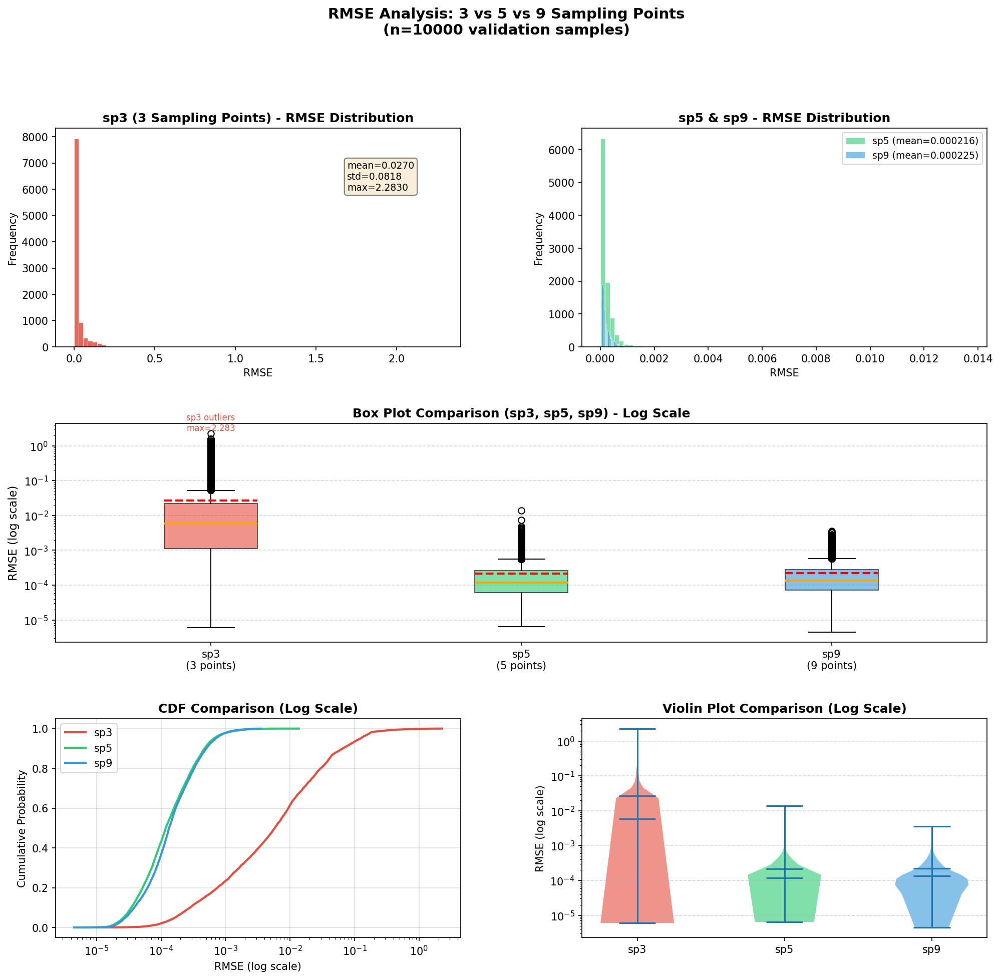

# 采样点数量对模型预测误差的影响分析

## 1. 数据概览

| 指标 | sp3 (3点) | sp5 (5点) | sp9 (9点) |
|------|-----------|-----------|-----------|
| 样本数 | 10,000 | 10,000 | 10,000 |
| 均值 | 0.026979 | 0.000216 | 0.000225 |
| 中位数 | 0.005795 | 0.000118 | 0.000133 |
| 标准差 | 0.081806 | 0.000334 | 0.000276 |
| 最小值 | 0.000006 | 0.000006 | 0.000004 |
| 最大值 | 2.283012 | 0.013651 | 0.003537 |
| 偏度 | 10.92 | 11.20 | 4.04 |
| 峰度 | 175.87 | 310.72 | 25.95 |

## 2. 核心结论

**sp3 误差显著高于 sp5 和 sp9，而 sp5 与 sp9 性能接近。**

- **sp3 均值误差是 sp5/sp9 的 ~125 倍**（0.027 vs 0.00022）
- **sp5 与 sp9 性能差异极小**：sp5 均值比 sp9 低 3.9%，但标准差高 21%
- **sp3 存在极端异常值**，最大误差达 2.28；sp5 最大 0.014；sp9 最大仅 0.004

## 3. 分位数对比

| 分位数 | sp3 | sp5 | sp9 |
|--------|-----|-----|-----|
| P1 | 0.000072 | 0.000017 | 0.000019 |
| P25 | 0.001136 | 0.000062 | 0.000073 |
| P50 (中位数) | 0.005795 | 0.000118 | 0.000133 |
| P75 | 0.021862 | 0.000259 | 0.000275 |
| P90 | 0.065900 | 0.000471 | 0.000503 |
| P95 | 0.123704 | 0.000658 | 0.000706 |
| P99 | 0.298829 | 0.001489 | 0.001342 |

**关键观察**：
- sp5 和 sp9 在各分位数水平上表现极为接近（P50 差异 ~12.7%）
- sp3 的 P99（0.299）超过 sp5/sp9 的 P99（~0.0015）约 **200 倍**
- sp9 的 P99 比 sp5 低 9.9%，说明尾部控制更好

## 4. 误差阈值覆盖率

| 阈值 | sp3 | sp5 | sp9 |
|------|-----|-----|-----|
| < 0.001 | 23.42% | **97.75%** | **97.86%** |
| < 0.005 | 47.20% | 99.98% | **100.00%** |
| < 0.01 | 61.60% | 99.99% | **100.00%** |
| < 0.05 | 87.74% | **100.00%** | **100.00%** |

**关键观察**：
- sp5 和 sp9 在 0.001 阈值下覆盖率均超过 97.7%，sp3 仅 23.4%
- sp9 在 0.005 阈值下达到 100%，sp5 达 99.98%
- 增加采样点从 5 到 9，边际收益极小

## 5. 分布特性分析

### 5.1 偏度与峰度
- **sp3**：高正偏度（10.92）+ 极高峰度（175.87），存在大量极端正误差
- **sp5**：偏度更高（11.20）但峰度极高（310.72），说明误差高度集中于低端但有厚尾
- **sp9**：偏度最低（4.04）+ 峰度最低（25.95），分布最为集中紧凑

### 5.2 离散程度
| 指标 | sp3 vs sp5 | sp5 vs sp9 |
|------|------------|------------|
| 均值比 | 124.9x | 0.96x |
| 标准差比 | 244.9x | 1.21x |
| 极值比(最大) | 167.2x | 3.86x |

## 6. 可视化分析

### 6.1 直方图（左上：sp3；右上：sp5&sp9）
- **sp3**：严重右偏分布，存在从 0 到 2.28 的宽范围拖尾，most样本聚集在低误差区但有显著长尾
- **sp5/sp9**：分布高度相似，均呈强右偏，sp9 分布更紧凑（蓝色峰更尖锐）

### 6.2 箱线图（中）
- sp3 存在大量极端离群点（max=2.28），无法在 log 坐标下完全显示
- sp5 和 sp9 箱体几乎重叠，sp9 的上须更短（max=0.0035 vs 0.0137）
- 三者的中位数（橙色线）和均值（红色虚线）差异明显

### 6.3 累积分布函数 CDF（左下）
- sp5 和 sp9 的 CDF 曲线几乎重合，在 10⁻³~10⁻² 区间几乎无法区分
- sp3 的 CDF 明显右移，说明整体误差分布偏高

### 6.4 小提琴图（右下）
- sp3 的小提琴形状宽而长，表明误差分布分散
- sp5 和 sp9 小提琴形状瘦长且高度相似，sp9 略窄

## 7. 综合评价

| 维度 | sp3 | sp5 | sp9 | 胜出 |
|------|-----|-----|-----|------|
| 中心趋势（均值） | 最差 | **最佳** | 次之 | sp5 |
| 离散程度（标准差） | 最差 | 较优 | **最佳** | sp9 |
| 极端值控制（最大值） | 最差 | 较优 | **最佳** | sp9 |
| 尾部风险（P99） | 最差 | 较优 | **最佳** | sp9 |
| 分布紧凑度（峰度） | 较优 | 最差 | **最佳** | sp9 |

**最终建议**：
- **sp3 不推荐使用**，其误差水平比 sp5/sp9 高两个数量级，存在严重极端值风险
- **sp5 与 sp9 性能相当**，sp5 均值略低（优 3.9%），sp9 尾部控制和标准差更优
- 若计算资源允许，选择 **sp9** 可获得更稳定、可控的误差分布
- 若追求最低均值误差，**sp5** 是最优选择

---

*分析基于 10,000 个验证样本的 RMSE 数据*
